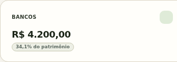
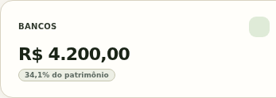
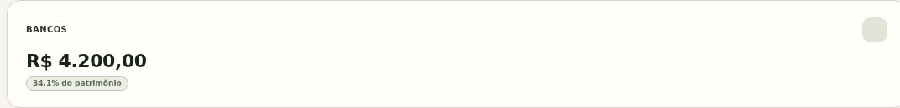
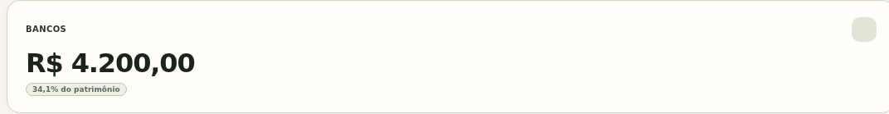

# C6-INICIO-02 — comparativo do card Bancos (antes/depois)

Fonte: capturas do harness CDP com dados fictícios e tema `light-1`.

## Medições consolidadas

| Viewport | Antes: fonte / altura | Depois: fonte / altura | Diferença |
|---|---|---|---|
| 320×720 | 18px / 121,80px | 22px / 123,89px | +4px na fonte, +2,09px na altura |
| 360×800 | 18px / 121,80px | 22px / 123,89px | +4px na fonte, +2,09px na altura |
| 390×844 | 18px / 121,80px | 22px / 123,89px | +4px na fonte, +2,09px na altura |
| 768×1024 | 18,432px / 125,80px | 23,04px / 128,98px | +4,61px na fonte, +3,18px na altura |
| 1280×800 | 22px / 129,80px | 32px / 138,39px | +10px na fonte, +8,59px na altura |

Caixinhas e Investimentos permaneceram com `18px` em 320/360/390, `18,432px` em 768 e `22px` em 1280.

## 390×844 — viewport mobile de referência

Antes:

Depois:

## 1280×800 — desktop

Antes:

Depois:

## Interpretação

O saldo passou a ser a informação dominante do card, sem alterar a largura ocupada, a posição na grade, o alinhamento ou a hierarquia dos módulos seguintes. O `line-height: 1.05` compensou parte do aumento da fonte, limitando o crescimento da altura a +2,09px no mobile e +8,59px no desktop.
